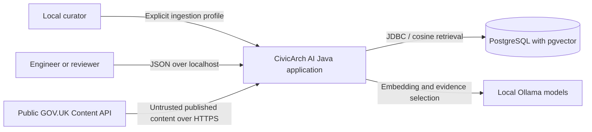
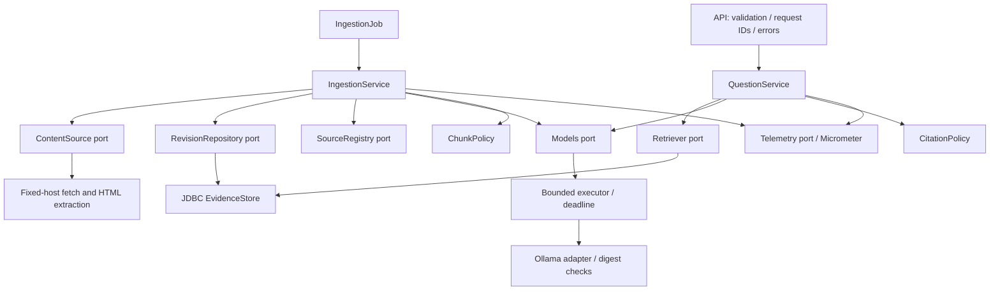

# Architecture Definition Document

| Control | Value |
|---|---|
| Document ID / version | CA-ADD / 1.0 |
| Status | Draft for maintainer review; approval pending |
| Scope | CivicArch AI, Milestone 1, local backend |
| Date | 15 November 2026 |
| Related documents | [Requirements](architecture-requirements.md), [Detailed design](detailed-design.md), [API specification](api-specification.md) |

## 1. Purpose and framework tailoring

This document provides the qualitative architecture and high-level design (HLD). It uses TOGAF Architecture Definition Document terminology and organizes views by business, data, application and technology concerns. The companion Architecture Requirements Specification contains measurable obligations. Detailed Design and API Specification are supporting engineering artifacts chosen for this repository.

This is a tailored application of TOGAF concepts, not a claim of TOGAF certification or independently assessed conformance. No enterprise architecture board or formal approval is implied. The [Open Group overview](https://help.opengroup.org/hc/en-us/articles/32726995273362-Understanding-the-TOGAF-Standard) explains tailoring and the Architecture Content component. Detailed standard content required sign-in during research; this project does not reproduce proprietary templates.

## 2. Architecture vision, scope and stakeholders

CivicArch AI helps engineers, architects, delivery leads and reviewers locate published UK government technology guidance with independently inspectable evidence. Benefits such as reduced research effort are hypotheses requiring evaluation, not measured outcomes.

| Stakeholder | Concern | View / requirement |
|---|---|---|
| Guidance user / reviewer | Relevant evidence and honest limits | Query flow; CA-EVD-01–03 |
| Contributor / maintainer | Reproducible builds and understandable boundaries | Technology view; CA-QLT-01 |
| Content curator | Approved sources, change tracking and freshness | Data view; CA-ING-01–04 |
| Security reviewer | Injection, SSRF, disclosure and resource exhaustion | Risk view; CA-SEC-01–03 |

M1 includes public-source ingestion, provenance, versioning, local models, vector retrieval, cited excerpts, abstention and health. Accounts, private document uploads, agents, chat memory, cloud deployment, architecture assessment and compliance certification are outside the implemented scope.

## 3. Principles and design decisions

| Decision | Rationale / consequence |
|---|---|
| Modular monolith | One application and database simplify local operation and transactional publication. No broker or microservices. |
| Evidence before generation | Application code owns source identity and renders exact excerpts. The model selects evidence IDs only. Relevance still requires evaluation. |
| Public, curated sources | Registry-controlled GOV.UK paths limit acquisition and provenance risk; no user-provided ingestion URLs. |
| Explicit JDBC and Flyway | SQL makes pgvector retrieval and publication transactions visible; migrations own schema evolution. |
| Immutable embedding identity | Tag, resolved digest and dimension identify an embedding space; incompatible indexes require reindexing. |
| Honest failure and freshness | Empty/withdrawn content is excluded; transient errors preserve previous evidence with visible ERROR freshness. |
| Local, bounded operation | Localhost binding, bounded inference, deadlines and conservative fetching constrain resources. |

These decisions consolidate the former ADRs; they describe implemented choices, not a separate approval record.

## 4. Baseline, target and gaps

The current baseline is the implemented Java backend, with quality gates and Docker-backed integration tests passing in the recorded local run. The M1 target additionally requires comprehensive evaluation and release/security evidence. There is no independently deployed enterprise baseline or separate transition deployment.

Remaining gaps include unexecuted remote CI/vulnerability scanning, unmeasured full evaluation, conditional HTTP fetching, and comprehensive publisher/third-party licensing review. These are tracked as gaps in the [requirements specification](architecture-requirements.md#3-verification-evidence-and-open-gaps), not described as achieved capabilities.

## 5. Architecture views

### 5.1 Business view

A curator approves public sources and explicitly runs ingestion. A user submits a question; a reviewer follows returned GOV.UK links and examines the cited passages. The service supplies informational excerpts, never an automatic policy decision or certification.

### 5.2 Context and technology view



Java 25, Maven Wrapper, Spring Boot 4.1.2 and Spring AI 2.0.2 support the single runtime. PostgreSQL/pgvector is managed locally through Compose; Ollama can run natively or through its optional Compose profile. MVC is the public interface. Actuator exposes health/info only; database readiness is distinct from model availability. No production hosting topology is asserted.

### 5.3 Application building blocks



Ports describe capabilities; adapters implement them. Domain policy is framework-free. Application code does not depend directly on JDBC or model SDKs. Supporting classes and transaction details are specified in the LLD.

### 5.4 Data view

Source documents own historical revisions; revisions own ordered chunks and embeddings. A source's current-revision pointer selects the only normally retrievable revision. Ingestion runs record aggregate outcomes. Raw payloads are hashed rather than logged. Public content retains its applicable licence; software licensing is separate in [NOTICE](../NOTICE.md).

## 6. Runtime interactions

```mermaid
sequenceDiagram
  actor Curator
  participant Job as Ingestion use case
  participant GOV as GOV.UK adapter
  participant AI as Bounded models
  participant DB as JDBC / PostgreSQL
  Curator->>Job: Run ingest profile
  Job->>DB: Create exclusive RUNNING record
  loop Enabled registry sources
    Job->>GOV: Fetch approved path
    GOV-->>Job: Status, metadata and semantic sections
    Job->>Job: Hash content, extraction/chunk policy and model identity
    alt Unchanged
      Job->>DB: Refresh source metadata without embedding
    else Changed active content
      Job->>AI: Embed all chunks
      Job->>DB: Transactionally publish complete revision
    else Unavailable or failed
      Job->>DB: Record state; preserve applicable prior revision
    end
  end
  Job->>DB: Finalize run counts
```

```mermaid
sequenceDiagram
  actor User
  participant API as MVC API
  participant Query as QuestionService
  participant DB as Retriever / JDBC
  participant AI as Bounded models
  User->>API: POST question
  API->>API: Validate JSON, size and request ID
  API->>Query: Bounded question
  Query->>AI: Embed question / verify model identity
  Query->>DB: Retrieve current eligible compatible chunks
  alt Evidence available within bounds
    Query->>AI: Select IDs using structured output
    Query->>Query: Strictly validate IDs; render stored excerpts
    Query-->>API: ANSWERED or abstention
  else No evidence
    Query-->>API: INSUFFICIENT_EVIDENCE
  end
  API-->>User: JSON and X-Request-Id
```

## 7. Security architecture and residual risks

| Asset / threat | Implemented control | Residual risk / requirement |
|---|---|---|
| Provenance / prompt injection | Fixed instructions; excerpts and questions treated as data; no tools; validated source IDs | Evidence selection can be irrelevant or incomplete; CA-EVD-03 |
| Index / SSRF and poisoning | Fixed HTTPS host, path registry, no redirect following, canonical-path checks | Upstream errors and registry edits need review; CA-SEC-01 |
| Secrets and privacy / disclosure | Environment credentials, no default prompt/body logging, generic errors, limited Actuator | Caller may submit sensitive text; local operation is not a public-hosting assurance; CA-SEC-02 |
| Compute / exhaustion | Payload caps, serial fetch, bounded executor and no queue, deadlines | Noncooperative calls retain workers until exit; CA-SEC-03 |
| Freshness / outages | Complete revision publication, ERROR freshness, exclusion of unavailable sources | Corpus may be stale; citations are not proof of current policy; CA-ING-04 |

Public internet hosting would require authentication, abuse prevention, secret management and independent security review. The independent-project disclaimer and OGL attribution remain visible in the README, NOTICE and API response.

## 8. Governance and change

The maintainer reviews architecture and source-registry changes through normal repository review. Requirement IDs remain stable; changed behaviour must update requirements, design, API contract and regression tests together. Historical revisions are retained indefinitely in M1. Schema changes use new migrations; embedding changes require a deliberate reindex. No automatic governance approval is implemented.
