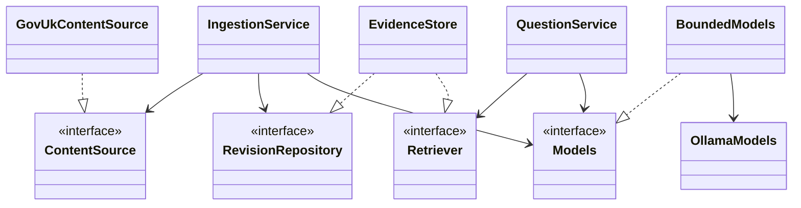
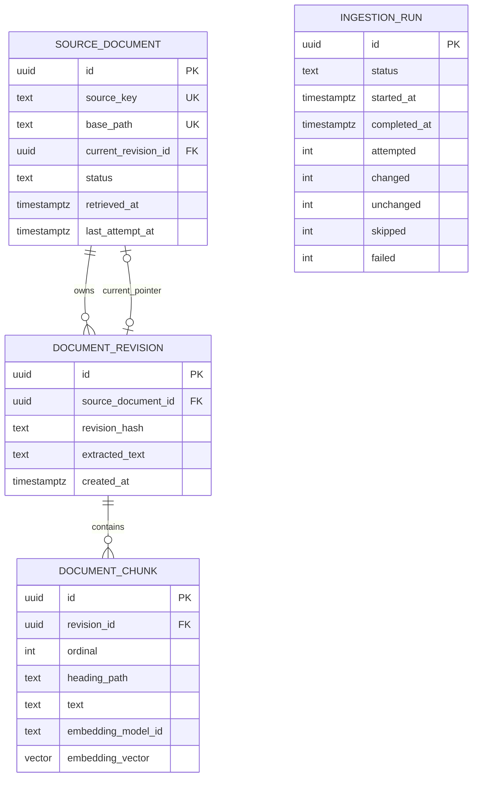

# Detailed Design Specification

| Control | Value |
|---|---|
| Document ID / version | CA-DDS / 1.0 |
| Status | Draft for maintainer review; approval pending |
| Scope / date | M1 implementation-level LLD / 15 November 2026 |
| Related documents | [Architecture definition](architecture-definition.md), [Requirements](architecture-requirements.md), [API specification](api-specification.md) |

## 1. Purpose and implementation baseline

This supporting engineering document refines the TOGAF-aligned architecture deliverables into implementable components. Java package root and Maven group ID are com.newroniq.civicarch. Java 25 uses no preview features. Spring Boot 4.1.2 and Spring AI 2.0.2 BOMs manage framework dependencies; Spring JDBC implements persistence. Schema is exclusively Flyway-managed. PostgreSQL pgvector uses cosine distance and HNSW indexing.

## 2. Components and interfaces

| Package / component | Responsibility |
|---|---|
| api / QuestionsController, RequestLimits, JsonConfiguration, Errors | MVC contracts, byte cap, generated correlation ID, strict JSON, validation and safe errors |
| application / QuestionService | Retrieve evidence, allocate references, validate selections and render stored excerpts |
| application / IngestionJob, IngestionService | Explicit non-web ingest profile; source iteration and aggregate run finalization |
| application / RuntimePolicy | Immutable configuration with constructor validation |
| domain / SourceRegistry, ContentSource, RevisionRepository, Retriever, Models, Telemetry | Ports for registry, acquisition, publication, search, inference and metrics |
| domain / PublishedContent, Evidence, ChunkPolicy, CitationPolicy | Value records, deterministic hashing/chunking and allowed-reference policy |
| infrastructure / Sources, GovUkClient, GovUkContentSource, ContentExtractor | YAML validation, controlled HTTPS, source-state classification and semantic extraction |
| infrastructure / EvidenceStore | JDBC queries and transactional revision publication |
| infrastructure / OllamaModels, ModelCatalog, BoundedModels, ModelHealth | Model calls, catalog digests, resource bounds and availability |
| infrastructure / MetricsTelemetry | Fixed operation/outcome metrics without question/source-text labels |

## 3. Acquisition and extraction

Sources loads external YAML from config/sources.yml. It checks unique keys/paths, supported topic and restricted path grammar, then exposes enabled entries. URL construction always uses https://www.gov.uk/api/content plus the approved path. GovUkClient serializes fetching, uses a descriptive user-agent, disables redirects, and applies connect/read timeouts. It accepts at most 2,000,000 response bytes. HTTP 429/5xx receive bounded exponential delay plus jitter; other HTTP failures are not retried. Transport exceptions propagate to source-level error handling.

GovUkContentSource maps redirects/404/410 to unavailable states, validates returned base_path and active content UUID, and extracts metadata. Explicit withdrawal or a nonempty withdrawn_notice means WITHDRAWN; an empty notice object is valid on an active page. Invalid acquisition is wrapped in ContentAcquisitionException; interruption propagates separately.

ContentExtractor supports HTML details.body and body fields in details.parts. It removes scripts/styles/navigation/footer, preserves selected headings, paragraph/list boundaries, normalizes whitespace/entities and stops at known related-guidance/contact furniture. Arbitrary recursive details shapes and hierarchical heading paths are not fully implemented. A part title is not a guaranteed parent heading; this is a known extraction limitation.

ChunkPolicy uses word-count approximation: 280 words with 40-word overlap by default, within each extracted section. token_estimate is ceil(character count/4), not a tokenizer measurement. SHA-256 revision identity includes extracted sections, extraction/chunk policy version and embedding identity. Chunk UUIDs derive deterministically from revision and ordinal; historical data is retained.

## 4. Versioning and publication

source_document also stores canonical URL, content ID, title, type, locale, publication timestamp, payload/content hashes, extraction version, last success and sanitized error summary. document_chunk stores content hash and token estimate. Uniqueness constraints cover revision hash per source and ordinal per revision. The current pointer is authoritative; no is_current flag is needed.

All embeddings are prepared outside the publication transaction. EvidenceStore then upserts/locks the source, inserts the revision and complete chunk set, and updates source metadata/current pointer atomically. A failed insert rolls back publication. Unchanged content refreshes verification metadata without embeddings. Registry-disabled sources are excluded by query keys.

V1 creates pgvector and provenance tables/indexes; V2 adds attempt timestamps and a unique partial index allowing one RUNNING ingestion record. A run ends COMPLETE or PARTIAL; a crash may leave RUNNING. Attempted is currently the registry size, including an interrupted run, not a strict count of completed fetch attempts. The original acquisition description and raw flags/payload are not fully persisted; hashes and selected metadata are retained.

## 5. Retrieval and evidence selection

The question embedding must match all eligible current embedding identities. Identity is configured tag plus resolved Ollama digest and dimension (`tag@digest/768`). Digest mutation in-process fails closed. After an intentional change, restart and reingest all enabled sources; a mixed active index rejects retrieval. A dimension change needs a new migration and rebuilt embeddings, not edits to an applied migration.

Retrieval joins chunks through source_document.current_revision_id, filters ACTIVE/ERROR and enabled registry keys, applies similarity floor and sorts by cosine distance then chunk UUID. Source keys are bound as a PostgreSQL text array using a fixed SQL statement; user data is never concatenated into SQL.

QuestionService constructs numbered evidence, bounds its size and requests a JSON array of integer IDs. OllamaModels explicitly sets the configured chat model, disables thinking and requests an array schema. CitationPolicy rejects unknown, duplicate, null and out-of-range IDs. Invalid output causes abstention. Valid IDs produce S-prefixed references from the original hit positions, so IDs need not be contiguous. Metadata and exact text are copied from hits; no model-provided URL/text is accepted. The implementation does not prove semantic relevance or absence of contradictory evidence.

## 6. Configuration and resource bounds

Defaults below are from [application.yml](../src/main/resources/application.yml). RuntimePolicy rejects inconsistent values; embedding dimension must equal the migration-defined 768.

| Property | Default / meaning |
|---|---|
| civicarch.sources | config/sources.yml; external approved registry |
| civicarch.runtime.similarity-floor / max-sources | 0.65 / 10; API default request is 5 |
| civicarch.runtime.prompt-characters / output-characters | 20000 evidence-context characters / 1024 model-selection characters |
| civicarch.runtime.concurrent-inference / inference-timeout-millis | 2 / 60000 per model operation |
| civicarch.runtime.chunk-words / overlap-words | 280 / 40 |
| civicarch.runtime.request-bytes / embedding-dimensions | 32768 / 768 |
| civicarch.fetch.attempts / interval-millis | 3 total attempts / 1000 minimum between fetch starts |
| civicarch.fetch.connect-timeout-millis / read-timeout-millis | 5000 / 20000 |
| spring.http.clients.connect-timeout / read-timeout | 5s / 60s configured framework client bounds |
| spring.ai.ollama.base-url | http://localhost:11434 |
| spring.ai.ollama.chat.options.model / num-predict | qwen3:4b / 1024 configured output-token limit |
| spring.ai.ollama.embedding.options.model | nomic-embed-text:v1.5 |
| server.address / port | 127.0.0.1 / 8080 |

A question-service semaphore bounds concurrent questions. BoundedModels uses a fixed-size executor and SynchronousQueue (no queued backlog), deadlines and cancellation. A noncooperative call retains its worker until exit; repeated timeouts cannot create unbounded workers. These are per-operation bounds, not a guaranteed end-to-end latency SLA. Configuration and credential environment variables are described in [README](../README.md).

## 7. Failure handling and recovery

| Condition | Behaviour |
|---|---|
| Null/empty/unsupported text | UNAVAILABLE; no empty embedding |
| Withdrawn / redirected | WITHDRAWN / REDIRECT; excluded from query |
| Fetch/model failure during reingestion | ERROR; previous revision retained and freshness visible |
| Interrupted ingestion | Restore interrupt, finalize run and stop; do not process remaining sources |
| Partial publication | Transaction rollback; previous current pointer survives |
| No/invalid selected evidence | HTTP 200 abstention; no citations |
| Dependency outage / deadline | Generic HTTP 503; no fallback to general knowledge |
| Inference saturation | HTTP 429 |
| Abandoned RUNNING record | Confirm no ingestion process remains, then mark that UUID FAILED before retrying; recovery SQL in README |

last_attempt_at tracks failed attempts separately. retrieved_at is the last successful content verification time, refreshed for unchanged content. indexAsOf is the oldest verification time among returned retrieval hits; it is not a global index snapshot. Model health reports catalog availability, not guaranteed successful generation. Database readiness is checked independently. Retention is indefinite; intentional volume deletion is documented, and automatic pruning is absent.

## 8. Verification and observability

Surefire runs unit/HTTP/adapter/architecture tests; Failsafe runs the real PostgreSQL/pgvector scenario. Checkstyle and Spotless enforce code hygiene/formatting. JaCoCo combines execution data and enforces 80% line, 70% branch and 90% citation-policy branch coverage, excluding only the launcher. ArchitectureTest checks application/domain boundaries. Commands and report locations are in [CONTRIBUTING](../CONTRIBUTING.md); evidence status is in [requirements](architecture-requirements.md#3-verification-evidence-and-open-gaps).

Telemetry uses fixed QUESTION/RETRIEVAL/INGESTION and SUCCESS/ABSTAIN/FAILURE values; model timers label only operation and fixed failure reasons. Questions, answers and excerpts are not logged by default. The executable [evaluation harness](../scripts/evaluate.py) and [labelled cases](../evaluation/questions.jsonl) remain; full evaluation has not been executed. Requirements describe the additional independent citation and relevance checks needed.

## 9. Source-validation evidence

The following Content API responses were inspected on 15 November 2026. All had a usable details.body. Technology Code uses detailed_guide; all listed Service Standard points use service_manual_guide. This is a historical observation, not a freshness guarantee. The overview /service-manual/service-standard returned an empty body and was replaced by point 5. The authoritative editable registry is [config/sources.yml](../config/sources.yml).

| Canonical source | Content ID |
|---|---|
| [/guidance/the-technology-code-of-practice](https://www.gov.uk/guidance/the-technology-code-of-practice) | 0996d757-6e1a-4313-b8fa-90516695ef58 |
| [/service-manual/service-standard/point-1-understand-user-needs](https://www.gov.uk/service-manual/service-standard/point-1-understand-user-needs) | 4f003517-3615-488a-a40a-895f0a5305eb |
| [/service-manual/service-standard/point-10-define-success-publish-performance-data](https://www.gov.uk/service-manual/service-standard/point-10-define-success-publish-performance-data) | 9b82c9ff-2b68-4cc6-8e3b-2a030586e0e3 |
| [/service-manual/service-standard/point-11-choose-the-right-tools-and-technology](https://www.gov.uk/service-manual/service-standard/point-11-choose-the-right-tools-and-technology) | 2673408d-a3c8-49ab-be56-d0b6997bd382 |
| [/service-manual/service-standard/point-12-make-new-source-code-open](https://www.gov.uk/service-manual/service-standard/point-12-make-new-source-code-open) | 99770f28-9baa-45b8-8022-8dd5a9775750 |
| [/service-manual/service-standard/point-13-use-common-standards-components-patterns](https://www.gov.uk/service-manual/service-standard/point-13-use-common-standards-components-patterns) | bd263037-8d33-4f93-a1a9-6478d06361dc |
| [/service-manual/service-standard/point-14-operate-a-reliable-service](https://www.gov.uk/service-manual/service-standard/point-14-operate-a-reliable-service) | a23a20cf-5426-4423-8099-279e11c7078a |
| [/service-manual/service-standard/point-5-make-sure-everyone-can-use-the-service](https://www.gov.uk/service-manual/service-standard/point-5-make-sure-everyone-can-use-the-service) | 174c41e0-3316-4e9d-be46-6555d52f3cb7 |
| [/service-manual/service-standard/point-8-iterate-and-improve-frequently](https://www.gov.uk/service-manual/service-standard/point-8-iterate-and-improve-frequently) | 16343329-a13e-45a8-8fc0-fa8f710ff672 |
| [/service-manual/service-standard/point-9-create-a-secure-service](https://www.gov.uk/service-manual/service-standard/point-9-create-a-secure-service) | 5635495c-4b48-4ee3-8ec5-55807b2b5998 |
